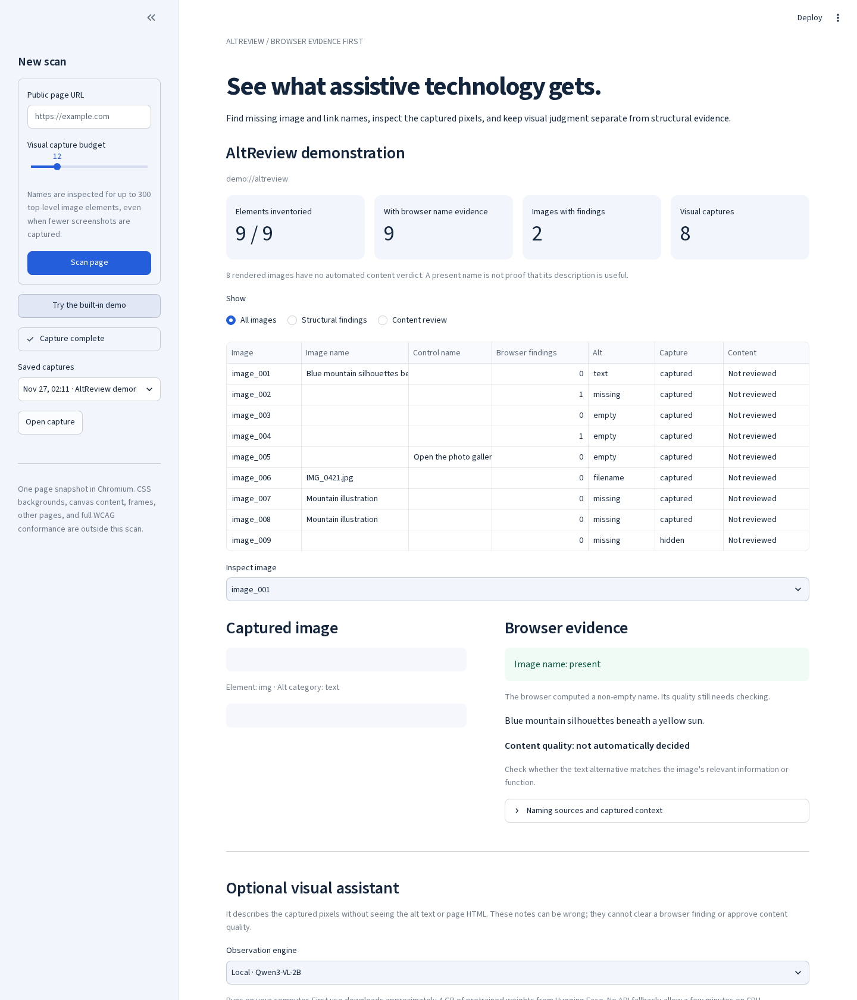

# AltReview

Image accessibility evidence from a real browser, with an optional local visual assistant.

AltReview opens a public page in Chromium, inventories its image elements, and reads the **actual computed accessible names** of images and enclosing links/buttons. It flags empty names, captures visible pixels, and exports a portable evidence report. It keeps structural checks separate from visual quality: a non-empty name can still be misleading, and an empty alt can be appropriate.



## Run locally

Use Python **3.11 or 3.12**. On macOS, run these commands inside the downloaded or cloned project folder:

```bash
python3 -m venv .venv
source .venv/bin/activate
python -m pip install -r requirements.txt
python -m playwright install chromium
python -m streamlit run app.py
```

If you use Conda, see [the migration commands](docs/migration.md).

Click **Try the built-in demo**. It requires no API key or model download. The demo includes a missing image name, an unnamed artwork link, a caption outside a link, a correctly named link, a title-based alternative, a decorative image, and a filename alt.

The previous `python -m streamlit run review_app.py` command also launches the new interface. Press **Control+C** in the terminal to stop it.

## How it works

1. Open one page at a fixed 1280 × 900 viewport; scroll a bounded distance to trigger some lazy loading.
2. Inventory up to **300** top-level `img`, `[role="img"]`, and `input[type="image"]` elements. Read DOM metadata and Chromium accessibility-tree evidence for all inventoried elements.
3. Check image and enclosing link/button names. Chromium resolves ARIA references, title alternatives, and descendant text. A caption outside a link does not automatically name that link.
4. Capture up to **12 visible images** by default, configurable to 50. Hidden and unsuccessful captures do not consume the successful screenshot budget. Name coverage and screenshot coverage are reported separately.
5. Optionally generate a literal visual description. The model receives **only pixels**, with no alt, DOM, expected label, or browser verdict. It cannot override findings or approve content quality.
6. Export escaped, self-contained HTML or raw JSON with browser names, naming sources, capture hashes, timestamps, and optional model provenance. An optional personal decision is stored with that capture.

### What the results mean

| Result | Meaning |
|---|---|
| Image/control name missing | Chromium exposes a relevant image or link/button with an empty computed name. A structural finding. |
| Image/control name present | That atomic name check passed. Description quality has not been established. |
| Inapplicable | The browser excludes the node or exposes a role outside this particular name check. |
| Unknown | Browser evidence could not be collected. It is never counted as a pass. |
| Content not reviewed | Whether the alternative conveys the image's purpose remains unresolved. Applies even when a descriptive alt exists. |
| Model observations | Unverified scene description and visible text. These are assistance, not an accessibility verdict. |

A filename or generic alt prompts content review rather than an automatic violation. Empty alt alone is not a failure. This tool does **not** award a page-level accessibility score or certify WCAG compliance.

## Optional local visual assistant

```bash
source .venv/bin/activate
python -m pip install -r requirements-local.txt
python -m streamlit run app.py
```

Select **Local · Qwen3-VL-2B**, then **Describe this image**. The first use downloads roughly 4 GB from Hugging Face. Later runs reuse the weights and successful observation cache. macOS uses MPS when available; CUDA and CPU are supported. CPU inference can be slow. No OpenAI fallback occurs.

The model is the **pretrained** `Qwen/Qwen3-VL-2B-Instruct`, pinned to revision `89644892e4d85e24eaac8bacfd4f463576704203`. This project does not train or fine-tune those weights. Visual processing is bounded to 262,144 pixels, with a 256-token generation budget. The generation time limit is 120 seconds after loading, checked between decoding steps; model loading is outside that limit. Invalid or truncated output is an error and remains retriable.

The local model's visual descriptions have **not** been validated as an accessibility classifier. Cached notes identify the image hash, model revision, prompt/schema, device, and elapsed time. Changing an alt does not change a pixel-only observation.

### Optional paid observations

```bash
python -m pip install -r requirements-openai.txt
read -s "OPENAI_API_KEY?Paste API key: "
export OPENAI_API_KEY
python -m streamlit run app.py
```

The `read` syntax above is for macOS's default **zsh**. Select **OpenAI · paid API**. Clicking the description button sends that captured image to OpenAI. The default model is `gpt-4.1-mini`; override it with `ALTREVIEW_OPENAI_MODEL`. No request runs automatically. Never commit a key; `.env` files are ignored and are not loaded automatically.

## Reproduce the checks

```bash
python -m unittest discover -s tests -v
python -m altreview benchmark
python -m altreview demo
python -m altreview scan https://example.com --captures 12
python -m altreview export runs/v2/SCAN_ID/scan.json report.html
```

The included W3C ACT **23a2a8** regression set contains **18 pinned cases**: 8 expected passed, 5 failed, and 5 inapplicable. Unaltered source HTML and the original image assets are served offline at their original URLs. Reference labels are loaded only after browser predictions. All cases remain in the denominator, including errors.

The recorded run matched **18/18 references** in Chromium 141.0.7390.37. This is agreement on **one atomic image-name rule**. It measures neither visual-description accuracy nor full WCAG conformance. The original API and local-model prototype scores do not apply to this rebuild. See [the measured report](evaluation/act/report.json) and [evaluation notes](docs/evaluation.md).

## Limits and data

- One top-level page snapshot, one Chromium version, one viewport. No site crawl, authenticated pages, iframe traversal, general SVG/canvas analysis, or arbitrary CSS background discovery. Explicit `[role="img"]` elements are included.
- Dynamic content, lazy loading beyond the bounded scroll, occlusion, animation, shadow DOM, and browser/assistive-technology differences can affect captures. A screenshot can include overlays. Capture errors and partial crops are retained.
- A missing image name is a browser-backed finding, not an exhaustive legal or WCAG determination. Name quality and whether hidden/decorative treatment is appropriate require context.
- This is a **local application**, not a hardened multi-tenant URL-fetching service. Public address validation rejects local/private destinations, but does not claim complete protection against DNS rebinding or every browser network mechanism. Do not expose it as an unrestricted public scanner.
- Scans and screenshots stay under ignored `runs/v2/`. They can contain page content and URLs. Local observation runs keep pixels on your computer after the initial weight download; the paid provider sends pixels only on an explicit click.
- Runtime outputs from the old prototype are not imported. Existing files are not deleted. Scan a fresh page in this version.

## Why this replaces the prototype

The old pipeline let a small vision model judge DOM facts, combined structural checks with subjective visual judgments, and displayed broad pass/fail labels. That encouraged confident explanations unsupported by browser evidence. The rebuild narrows automatic findings to facts we can inspect, records actual naming sources, and makes unresolved content quality visible.

The entire earlier implementation and experiments are preserved on [prototype-v5](https://github.com/Nurs333/hybrid-wcag-review/tree/prototype-v5). Historical public datasets are regression material, not evidence of unseen-model generalization.

## Layout

```text
altreview/       capture, browser checks, visual notes, reports, UI, CLI
app.py           Streamlit entry point
review_app.py    compatible launcher
tests/          browser, UI, evidence, caching, and evaluation contracts
evaluation/act/ pinned source fixtures, references, and measured report
docs/           architecture and evaluation scope
```

Sources: [W3C image-name rule](https://www.w3.org/WAI/standards-guidelines/act/rules/23a2a8/), [W3C image decision tree](https://www.w3.org/WAI/tutorials/images/decision-tree/), [Chromium accessibility protocol](https://chromedevtools.github.io/devtools-protocol/tot/Accessibility/), [Qwen model card](https://huggingface.co/Qwen/Qwen3-VL-2B-Instruct). See [third-party notices](THIRD_PARTY.md).
