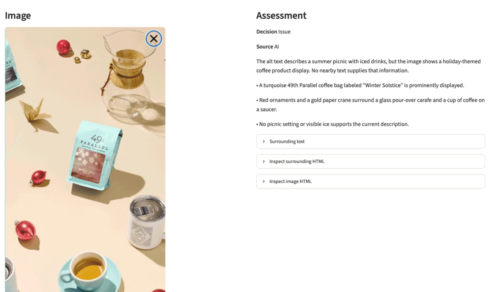

# Public webpage case study

**Page:** [49th Parallel Coffee Roasters — Main Street](https://49thcoffee.com/pages/main-st)  
**Date:** November 24, 2026  
**Method:** Chromium capture, rule checks, OpenAI image assessment, then human review  
**Model recorded in the export:** `gpt-6.2-sol`

The scanner found six `img` elements at the captured desktop viewport. Three were visible and captured; three were recorded as not visible and skipped for AI assessment. All three captured images were sent to the model because the rules did not flag them.

| Image | Existing alternative | AI decision | Human decision |
| --- | --- | --- | --- |
| `image_001` | 49th Parallel Coffee Roasters | Pass | Pass |
| `image_005` | 49th Parallel Coffee Roasters logo | Pass | Pass |
| `image_006` | Summer picnic with iced coffee drinks | Issue | Issue |

## Finding

The third captured image shows coffee products and brewing equipment arranged with holiday ornaments. Its alternative describes a summer picnic with iced drinks. The model identified that mismatch despite the presence of a nonempty alt attribute. The reviewer agreed after examining the image and the model's explanation.

A possible replacement, subject to the page owner's intended image purpose, is:

> 49th Parallel coffee products and brewing equipment arranged with holiday ornaments.

This is an image-alternative finding, not a full-page accessibility verdict. The image is animated; the captured evidence represents its state at capture time. The prototype used the nearest surrounding element for context, which may omit relevant content elsewhere on the page.

## Interpretation

This example demonstrates browser capture, a live model request, evidence display, and saved human decisions on a public page. The reviews were made after the automated assessments were visible and with discussion of the flagged finding. They are assisted reviews, not independent reference labels. Agreement on three images is not a real-world accuracy estimate.

The three skipped elements were not assigned pass or issue decisions. Visual invisibility alone does not establish whether an element is exposed to assistive technology.

The [sanitized report](reports/49th-parallel-main-st.json) preserves the observations, model explanations, and final human decisions. Local capture paths and API response identifiers have been omitted. This page and its assets can change; the report describes the recorded scan only. The coffee shop did not commission or endorse this project.
